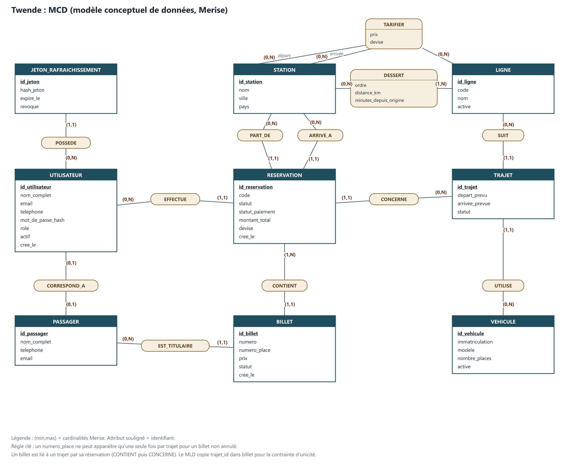
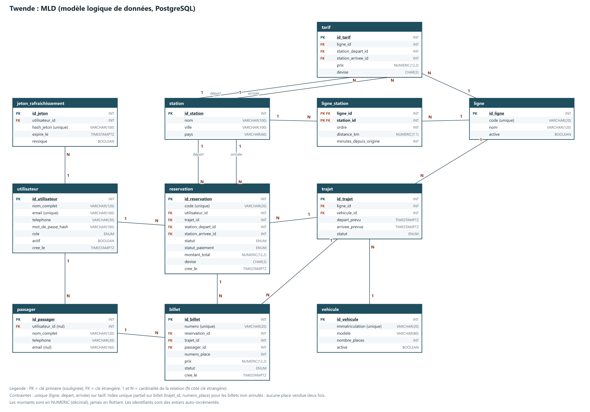

# 02 - Conception de la base de données

Base : **PostgreSQL 18**. Accès par **Prisma** (ORM autorisé par l'énoncé).
Le script `conception/schema.sql` est la version de conception. Les migrations Prisma seront générées à partir du même modèle.

## 1. Les trois schémas

Images prêtes pour le rapport (PNG pour Word, SVG pour la qualité maximale) :

| Schéma | Image | Source vectorielle |
|---|---|---|
| MCD (Merise) | `conception/mcd.png` | `conception/mcd.svg` |
| MLD | `conception/mld.png` | `conception/mld.svg` |
| Cas d'utilisation | `conception/cas-utilisation.png` | `conception/cas-utilisation.svg` |

## 2. Lecture du MCD

Les cardinalités se lisent « (min,max) côté entité ».

| Association | Lecture |
|---|---|
| UTILISATEUR (0,N) - EFFECTUE - (1,1) RESERVATION | Un utilisateur fait plusieurs réservations. Une réservation est faite par un seul utilisateur. |
| RESERVATION (1,N) - CONTIENT - (1,1) BILLET | Une réservation a au moins un billet. Un billet appartient à une seule réservation. |
| PASSAGER (0,N) - EST_TITULAIRE - (1,1) BILLET | Un billet a un seul titulaire. |
| TRAJET (0,N) - CONCERNE - (1,1) RESERVATION | Une réservation porte sur un seul trajet. |
| LIGNE (0,N) - SUIT - (1,1) TRAJET | Un trajet suit une seule ligne. |
| VEHICULE (0,N) - UTILISE - (1,1) TRAJET | Un trajet utilise un seul véhicule. |
| LIGNE (1,N) - DESSERT - (0,N) STATION | Une ligne dessert au moins une station. L'association porte l'ordre, la distance et la durée depuis l'origine. |
| LIGNE, STATION, STATION - TARIFIER | Association ternaire : un prix pour (ligne, départ, arrivée). |
| STATION - PART_DE / ARRIVE_A - RESERVATION | Une réservation a une station de départ et une d'arrivée. |
| UTILISATEUR (0,1) - CORRESPOND_A - (0,1) PASSAGER | Un passager peut être lié à un compte, mais pas toujours (client du guichet). |
| UTILISATEUR (0,N) - POSSEDE - (1,1) JETON | Un utilisateur a plusieurs jetons de rafraîchissement. |

## 3. Passage du MCD au MLD

Règles appliquées :

- Une association (0,N)-(1,1) devient une **clé étrangère** du côté « 1,1 ».
- Une association (N,N) avec attributs (DESSERT) devient une **table** (`ligne_station`) dont la clé primaire est composée.
- L'association ternaire TARIFIER devient la table `tarif` avec 3 clés étrangères.
- **Choix volontaire** : `billet` reçoit une copie de `trajet_id` (qui existe déjà via la réservation). On l'a ajoutée pour pouvoir poser l'index unique `(trajet_id, numero_place)` directement sur `billet`. C'est une redondance contrôlée, expliquée ici.

## 4. Dictionnaire des tables

| Table | Rôle | Clés étrangères |
|---|---|---|
| `utilisateur` | Compte de connexion (admin, agent, passager) | - |
| `jeton_rafraichissement` | Jetons de renouvellement (empreinte, expiration, révocation) | utilisateur |
| `station` | Lieu d'arrêt (gare routière) | - |
| `ligne` | Route commerciale (ex. Goma - Kigali) | - |
| `ligne_station` | Arrêts d'une ligne, dans l'ordre | ligne, station |
| `tarif` | Prix par tronçon d'une ligne | ligne, station x2 |
| `vehicule` | Bus avec son nombre de places | - |
| `trajet` | Un départ planifié d'une ligne | ligne, véhicule |
| `passager` | Personne qui voyage | utilisateur (facultatif) |
| `reservation` | Achat de 1 à 6 places | utilisateur, trajet, station x2 |
| `billet` | Une place pour une personne, numéro unique | réservation, trajet, passager |

Énumérations : `role_utilisateur`, `statut_trajet`, `statut_reservation`, `statut_paiement`, `statut_billet`.

## 5. Normalisation

- **1FN** : toutes les colonnes sont simples (une valeur). Les places sont des lignes de `billet`, pas une liste.
- **2FN** : dans `ligne_station`, ordre, distance et durée dépendent de la clé complète (ligne, station).
- **3FN** : le prix est dans `tarif`, pas dans `ligne`. La ville est dans `station`.
- Une seule redondance voulue : `billet.trajet_id` (voir plus haut). Le prix copié dans `billet` et `reservation` est aussi voulu : il garde le prix payé même si le tarif change plus tard.

## 6. Points techniques sur les données

- **Montants** : `NUMERIC(12,2)`. En code, Prisma `Decimal`, jamais `number`.
- **Dates** : `TIMESTAMPTZ` (avec fuseau). Le serveur travaille en UTC.
- **E-mail unique** sans tenir compte des majuscules : index sur `lower(email)`.
- **Mots de passe** : seulement l'empreinte bcrypt dans `mot_de_passe_hash`.

## 7. Accès concurrents : le mécanisme choisi

**Risque** : deux passagers demandent la place 12 du même trajet au même moment. Sans protection, les deux lisent « place libre » puis les deux écrivent.

**Solution en deux couches** :

1. **Transaction avec verrou de ligne.** Au début de la réservation, on exécute dans une transaction :
   `SELECT id_trajet FROM trajet WHERE id_trajet = $1 FOR UPDATE`.
   Les réservations du même trajet passent donc l'une après l'autre. La seconde attend la fin de la première, puis voit la place prise et répond **409**.
2. **Contrainte d'unicité en base** : l'index unique partiel `uq_billet_place_par_trajet` sur `billet (trajet_id, numero_place) WHERE statut <> 'annule'`. Même si un bug de code oubliait le verrou, la base refuse le doublon. Le code convertit cette erreur en 409.

**Pourquoi les deux** : le verrou évite les erreurs en cascade et rend le comportement prévisible. La contrainte est le filet de sécurité qui ne dépend pas du code.

**Pourquoi verrouiller le trajet et pas chaque place** : les places ne sont pas des lignes en base (pas de table `place`). Verrouiller le trajet est simple à expliquer et suffisant : les réservations d'un même trajet sont courtes.

**Preuve** : un test automatisé lance 20 réservations en parallèle pour la même place. Résultat attendu : exactement 1 réponse 201 et 19 réponses 409. Un second test lance des réservations sur des places différentes : toutes réussissent.

## 8. Ce qui n'est pas fait (volontairement)

- Revente d'une place après la descente d'un passager (une place est bloquée pour tout le trajet).
- Interdiction de chevauchement de trajets d'un véhicule au niveau de la base : elle est contrôlée dans le code (RG12). Une contrainte d'exclusion PostgreSQL est possible plus tard.
