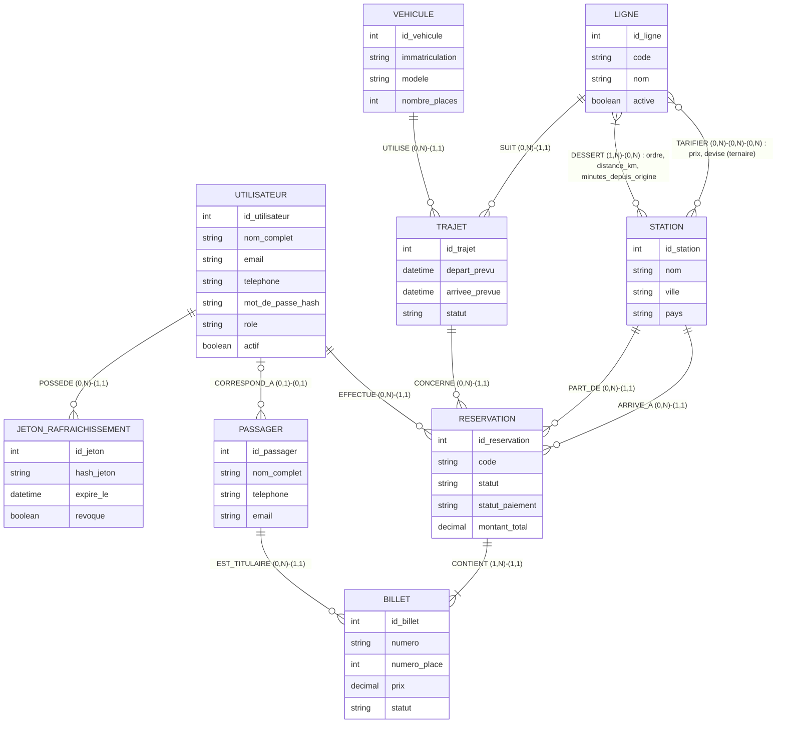
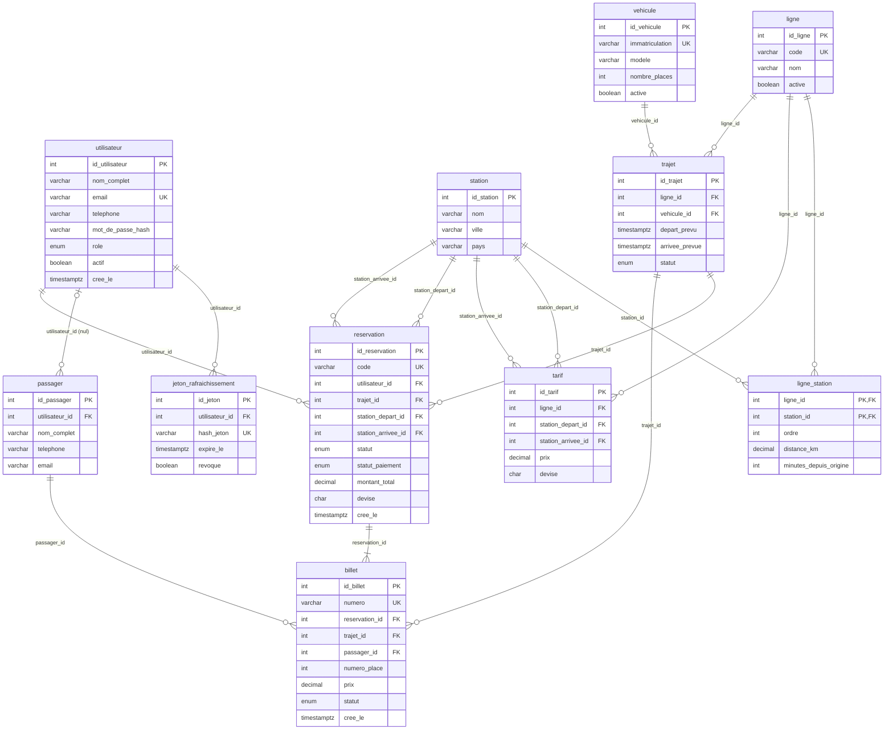
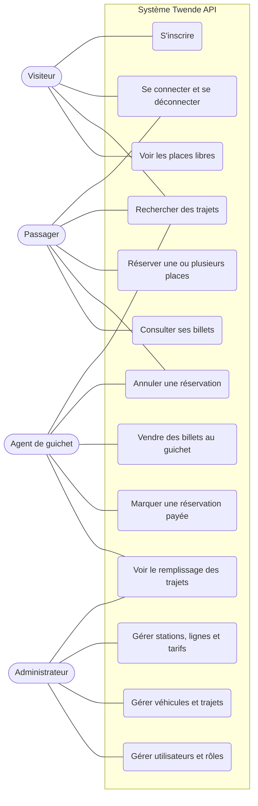
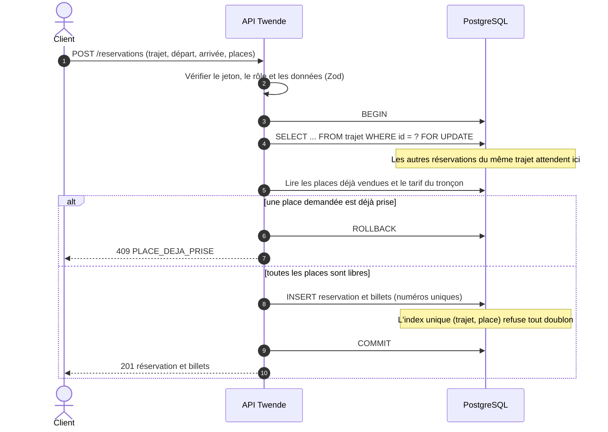
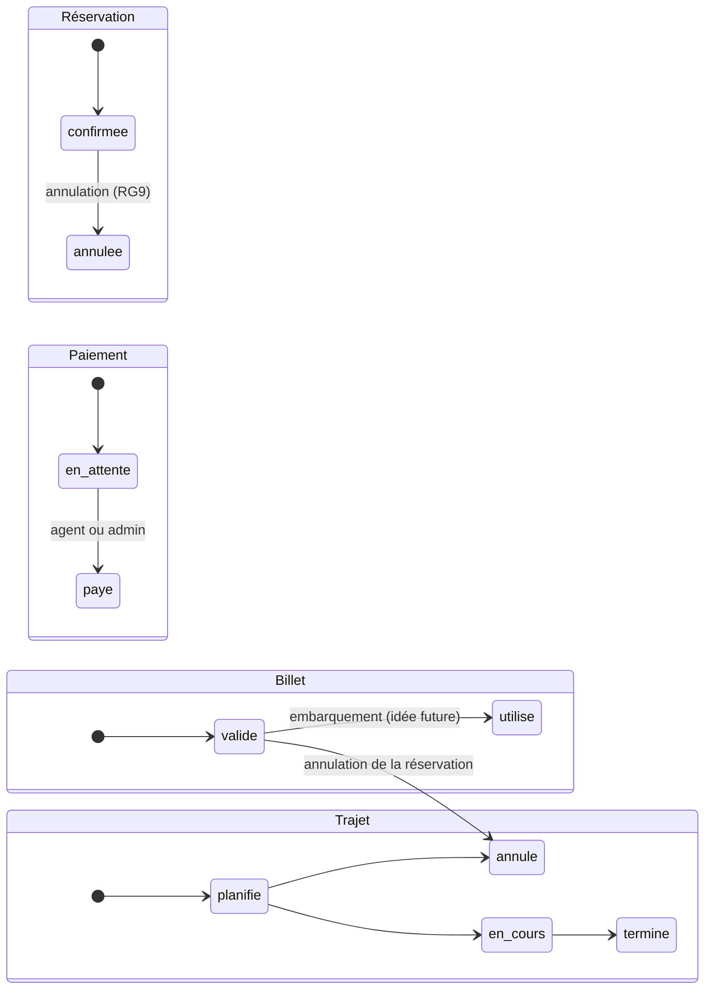
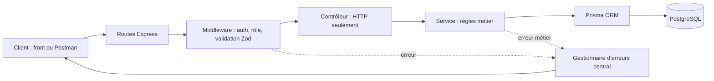

# Diagrammes de Twende API (version Markdown)

Ces diagrammes sont écrits en **Mermaid**. Ils s'affichent directement dans GitHub, VS Code (avec l'extension Markdown Preview Mermaid) et la plupart des outils Markdown.
Les images PNG et SVG de ce dossier (`mcd`, `mld`, `cas-utilisation`) restent la **version officielle** pour le rapport, car elles suivent la notation Merise exacte.

## 1. MCD (modèle conceptuel, cardinalités Merise dans les libellés)

Mermaid ne connaît pas la notation Merise. Les cardinalités (min,max) sont donc écrites dans le texte de chaque association, dans l'ordre « première entité, seconde entité ».

## 2. MLD (modèle logique : tables, clés primaires et étrangères)

Contrainte clé (hors schéma) : index unique partiel sur `billet (trajet_id, numero_place)` pour les billets dont le statut n'est pas `annule`.

## 3. Cas d'utilisation

## 4. Réservation de places (séquence, avec la protection contre les doublons)

## 5. États d'une réservation, d'un billet et d'un trajet

## 6. Architecture en couches

